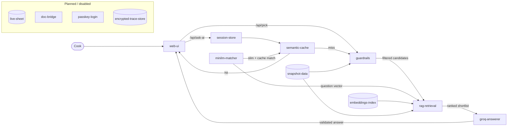

# Architecture

This file describes how the app is put together. It is updated in the same
commit as any architecture change, keeping section headings and diagram node
IDs stable so `git diff` shows exactly what each change touched.

## Current state (2026-10-27; last verified production = 6365f0a)

Production was browser-verified at 6365f0a on 27 October: dish and ingredient
checkboxes, two real AI requests, composed-note Load more, and named history
exclusions passed the changed-flow checks. This snapshot contains 62 recipe
cards (61 verified + 1 partial); the source library has newer extractions.
Saves, suggestions, sessions and encrypted traces still use per-instance
memory in demo mode and can reset. No durable-storage claim is made.

The stable sorting/diet revision is LOCAL until its exact deployed commit is
verified. It adds full-source name/view ordering before the video display cap,
stated-duration sorting and filters for checked cards, and conservative diet
contradiction checks for indexed video titles. Unknown durations, difficulty
and likes are not invented. Existing ranking, history and ingredient paging
semantics remain unchanged. Automatic Doc/socket replies remain unavailable;
no speculative transport or persistence adapter is included in this revision.

## Request flow (diagram)

## Components

| ID | Component | Role | State |
| --- | --- | --- |
| 2026-10-27 00:07 | fix/paging-ingredient-snapshot, based on main 02f932f | LOCAL ONLY, NOT RELEASED: fixed Load-more dropping ingredient chips. Initial Pick sends composedNote() but old Load-more sent raw pickForm.note. Snapshot now stores raw note for stale detection AND composed note for paging requests. Regression source-shape guard plus tests/pick-checkboxes.e2e.mjs actual network-body assertion verifies rice survives Load-more. Also fixes staged dish-zero wording: a matching dish excluded by history is named as already suggested in the last 30 days, not absent from the checked library. Local 390px matrix: dish-only Ask, ingredient-only second Ask, combined honest no-repeat zero, OR dishes plus ingredient AND, stale/reset, page retention, filter-change clears append state, keyboard Space chip sync; fake provider, not live provider quality. Production acceptance remains blocked by quota until live deploy can be checked. | --- |
| result-sorting | web/src/result-sort.ts + server/data.ts | Stable full-source video name/view ordering before pagination; checked-card stated-time sorting. Duration ranges sort by upper end and must fit the whole selected bucket; unknowns sort last. DEFAULT library order is Mixed channels: deterministic round-robin across channels (lossless, within-channel order kept) so channel-contiguous extraction batches never display as single-channel runs; explicit Original order still returns insertion order | Local revision; deployed acceptance pending |
| video-diet | server/video-diet.ts | Title contradictions downgrade indexed diet hints; explicit English/German egg words cannot pass pure-Veg filters. Unknown hints remain unknown. Indexed titles are not full ingredient verification | Local revision; deployed acceptance pending |
| web-ui | React app (Vite build) | Filters, picks, ask, history, comms. Default result sort is Mixed channels; pick/ask relevance lists are untouched (no channel field passed). Committed, awaiting build: pick results page via a Load more button - batches append, no duplicates, filters of the original search preserved, honest exhaustion message | Live (paging committed, awaiting build) |
| guardrails | Deterministic checks (server/pick.ts) | Verified-only, strict diet, exclusions, food words, 30-day no-repeat. Multiple food words combine as AND; question words are never interpreted as ingredients; a zero answer names the real cause with counts (no-repeat vs diet/meal vs own exclusion vs library gap). Always run BEFORE any model; no model can widen the pool. Post-output validation: an AI reason that denies a hard note word (e.g. "does not contain corn" on a corn-matched card) is hidden and disclosed in noteInfo - the deterministic match stands, false prose never renders | Live in production (365bf8b): AND semantics, question-word guard, staged zero-reasons. Committed, awaiting build: post-output reason validation |
| session-store | In-memory ask sessions (server/session.ts) | 30-min TTL; follow-ups like "another option" reuse stored diet/meal and hide what was just shown; reset via "New conversation" | Live (resets on restart) |
| semantic-cache | Answer reuse (server/semantic.ts) | A repeat question with the SAME constraints + library + intent is answered with 0 AI calls; "another option" and any constraint change bypass it | Live |
| rag-retrieval | Full-corpus retrieval (server/rag.ts) | Top video-index matches join the shortlist, labelled "video found - details not extracted yet"; details are never invented | Live (verified 2026-10-26 19:47 IST: production /api/state rag.ready=true with 4468 titles; a paneer ask returned 3 checked cards + 2 labelled video suggestions) |
| minilm-matcher | Local matching model (Xenova/all-MiniLM-L6-v2, pinned revision, Apache-2.0) | Turns question + titles into number patterns for meaning matching and the answer cache. Runs inside the app server; question/recipe text never leaves for matching. Pluggable: `SEMANTIC=off` disables it and the app falls back to plain word rules, honestly labelled | Live, optional |
| groq-answerer | Groq chat API (openai/gpt-oss-120b) | Writes the answer from the shortlist only; cited recipes are validated server-side, one corrective retry then honest reject | Live |
| snapshot-data | server/demo-data.json | Dated public video-derived copy of the library; private history never published | Live in production (64088bb): 62 cards (61 verified + 1 partial, 2026-10-26) |
| ingredient-typeahead | server/pick.ts typeaheadVocab + /api/ingredients + chips UI | Canonical ingredient words from the checked library (curated 141-word allowlist); tap/keyboard multi-select composed into ask + pick notes; zero AI per keystroke | Live in production (64088bb): vocab endpoint + chips UI + allowlist + multi-select |
| embeddings-index | server/demo-embeddings.json | Precomputed MiniLM vectors (int8) for all 4468 video titles; regenerated with each snapshot refresh | Live (bundling fixed by literal-__dirname tracing in 69315b9; verified with rag-retrieval) |
| live-sheet | Private Google Sheet | Source of truth for recipes, history, traces | Planned (needs account connection) |
| doc-bridge | Shared Google Doc | Chat bridge to the assistant | Disabled (notification unproven) |
| passkey-login | Fingerprint login | Optional sign-in addition | Not built |
| encrypted-trace-store | Sheet-backed trace | Persistent encrypted communication log | Planned (needs account connection); in-memory encrypted trace live meanwhile |

## Models and providers

- **Groq** (cloud): writes and explains answers. Sees only the shortlisted
  candidates plus the question. Measured 712-3926 tokens per ask
  (provider-reported); repeated identical asks use 0 (cache).
- **MiniLM** (local, in-app): meaning matching + cache only. Writes nothing.
  One 22 MB download per server instance from huggingface.co; bounded load
  (20 s timeout) with honest degradation; never blocks a request.

## Data storage

- Recipe cards + video index: snapshot files in this repo (public, video-derived only).
- Sessions, picks, history: per-instance memory in demo mode (reset honestly).
- Communication trace: encrypted (AES-256-GCM, key in server env), in-memory
  per instance in demo mode; token counts are provider-reported.

## Token minimization

1. Guardrails shrink the pool deterministically (free).
2. MiniLM ranks/slims what remains, so Groq sees ~25 candidates, not hundreds.
3. The semantic cache answers exact repeats with no Groq call.
4. Sessions send compact context (diet/meal/last ideas), not chat history.

## Trust boundaries

- The web UI talks only to this app's own API (token-gated when APP_TOKEN is set).
- Only Groq receives app content, and only the minimal shortlist per request.
- Matching (MiniLM) and retrieval are fully local to the app server.
- Private identifiers (Sheet ID, history, tokens) are never committed here.

## Deployment and fallbacks

- Vercel Hobby (free). The serverless bundle must explicitly include the JSON
  snapshots: vercel.json `functions["server.ts"].includeFiles` lists
  `web/dist/**`, `server/demo-data.json`, `server/demo-embeddings.json`
  (without this the embeddings index silently fails to load and retrieval
  degrades honestly). Builds trigger on push to main; a Deploy Hook
  (rebuild-main) exists as a manual fallback when push events stall. If
  MiniLM fails to load, the app says so and uses plain
  word rules. If Groq is down, asks return an honest error; picks still work
  unranked. If the embeddings index is missing, video suggestions simply stop
  (recipes still work).

## Change history

Newest first. SHAs are real commits on main.

| Date (IST) | Commit(s) | What changed |
| --- | --- | --- |
| 2026-10-26 20:35 | 365bf8b, 837bc57, 6cbfece | web-ui + api: pick fills a thin checked pool (<5) with labelled full-corpus video alternatives (not counted, not recorded, diet-hint filtered, unique ids); WhatsApp ask route includes selected chips; regression test 89 |
| 2026-10-26 21:15 | branch fix/canonical-ingredient (PR pending; merge SHA in git log once merged) | api: canonical-ingredient identity - a derived form ("corn starch/flour/syrup/oil", spaced or hyphenated) no longer counts as the ingredient itself, so corn-starch-only filler (Crispy Chips) cannot match a "corn" request; symmetric for all food words; reason-hiding kept as defense-in-depth; mobile tab row gets a visible thin scrollbar (390px reach); regression tests 95-96 (96/96 green) |
| 2026-10-26 22:25 | branch feat/dish-filter-ind (COMMITTED LOCALLY off main 27c22be, NOT PUSHED; independent of the unapproved paging branch) | api + web-ui: dish filter with typeahead, requested by the owner 26 Oct 22:13. /api/dishes serves dish identities of VERIFIED cards only (recipe_name minus parenthetical attributions, deduped, sorted; indexed video titles are never dish identities). Typeahead semantics shared with the ingredient filter via web/src/ta.ts (taFilter/taNav) - one implementation, zero AI per keystroke. Dish chips: server-enforced hard filter on the recipe NAME (every dish word must appear; ingredient mentions never count), OR across chips (a card is one dish), AND with note/ingredient constraints; honest staged zero. Dish chips also gate/constrain the Ask route (button enablement counts dish chips, candidates name-filtered, semantic-cache signature includes dishes, WhatsApp message lists them) and HARD-filter video alternatives by dish words in the title (no unrelated fill). Both pick inputs have persistent visible labels; OR wording stated in the UI; no-match state shown under the dish box. FOLLOW-UP at merge time: when this and feat/stable-paging both land, add `dishes` to corpusFingerprint inputs (3 hunks + test) so Load-more paging binds the dish filter. Tests 117/117 green on the stacked original; re-verified on this independent branch; web tsc clean |
| 2026-10-26 23:55 | branch feat/dish-filter-ind (COMMITTED LOCALLY on top of 8b369b6, NOT PUSHED) | web-ui: browsable checkbox lists under both pick inputs, requested by the owner 26 Oct 23:47. Collapsible Browse-dishes (59) and Browse-ingredients (145) lists with per-item checkboxes; checking/unchecking drives the SAME shared selDishes/selIngs chip state as the typeahead (DRY: one toggleSel helper in ta.ts), so list, typeahead, and chip-x removal stay in sync both ways; per-list Clear-all; zero /api calls on any checkbox toggle (verified in E2E). Also fixes a pre-existing gap: ingredient-chip changes now mark shown picks stale (pickForm snapshot includes ings), same as dish chips/note. 390px touch E2E: expand, check/uncheck, chip-x unchecks box, typeahead-select checks box, stale hint on toggle after pick, Clear-all + second run returns full 5-card pool; console clean. Unit test 105 (toggleSel) |
| 2026-10-26 23:58 | branch feat/dish-filter-ind (COMMITTED LOCALLY, NOT PUSHED) | web-ui + test: checkbox-list contrast fix (visual release-gate catch). .cbitem inherited the dark pick-panel's light text color onto the forced-white list panel - labels measured unreadable; now declares color: var(--ink) (measured 15.89:1 on the white panel, WCAG AA), plus hover leaf-tint and focus-visible outline for keyboard users. New server/ui-css.test.ts statically asserts .cbitem declares an explicit color with >= 4.5 contrast against the .cblist background so the unit suite catches CSS-only regressions; E2E adds a computed-style contrast assertion across both lists, unchecked + checked states. 106/106 green, web tsc clean |
| 2026-10-26 21:05 | branch rajsek-patch-1 (squash-merged as 1a164f1) | api + web-ui: (1) zero checked picks still get labelled video alternatives (thin-pool fill no longer requires picks > 0); (2) post-output validation hides AI reasons that deny a hard note word and discloses the hiding; (3) Load more paging: client sends the ids on screen as `seen`, server returns a disjoint next batch (browsing exclusion only - never touches 30-day history), honest "no more" at exhaustion; repeat-request sameness root-caused to per-instance serverless memory losing exclusions, fixed statelessly; regression tests 90-95 |
| 2026-10-26 20:23 | 3208a7f | web-ui: selected ingredient chips alone enable the Ask button (chips-only ask); committed, awaiting deploy |
| 2026-10-26 20:19 | e06f312 | build: npm run build runs tsc --noEmit -p web before vite so a missing import fails the build instead of shipping a blank page; committed, awaiting deploy |
| 2026-10-26 20:19 | 64088bb | web-ui hotfix: import useRef (blank-screen ReferenceError); deployed and live-verified (renders, 62 cards, AND pick, zero-reason, console clean, mobile) |
| 2026-10-26 19:57 | 7c091b5 | snapshot-data: 62 cards (61 verified + 1 partial), +2 paneer cards, 7 paneer video extraction statuses |
| 2026-10-26 19:56 | f81abc3, 4fb5f27, e076c65, 1707524 | guardrails: food words combine as AND; question words never interpreted as ingredients ("what" is not "wheat"); zero answers name the real cause with counts; honest-zero asks also offer labelled video alternatives |
| 2026-10-26 19:47 | 69315b9, 357baa5 | rag-retrieval + embeddings-index live-verified (production deployment of 112bc52; rag.ready=true, 4468 titles) |
| 2026-10-26 19:38 | 112bc52, 7f47c8c, d4c9f1f, 89f02fa, c217c54, bfb12c3, f7b2df8, df4eadf | ingredient-typeahead added: vocab endpoint, curated allowlist, multi-select chips; zero AI per keystroke |
| 2026-10-26 18:41 | dd59c44 | vercel.json: JSON snapshots explicitly included in the serverless bundle |
| 2026-10-26 18:34 | 73f1710 | architecture.md added (this file) |
| 2026-10-26 18:33 | 7f67f04 | embeddings-index added (4468 video-title vectors, int8) |
| 2026-10-26 18:27 | 2b6a23d, fb110ca, 272afa6, ea0610c | rag-retrieval added: video matches join ask shortlist with honest labels |
| 2026-10-26 18:22 | 213b21a, 8e7c134, 82d313d, fe86bdd, 073d61f | Guardrails fail closed without the classifier; absence answers qualified ("none under these filters", never "none in the library") |
| 2026-10-26 18:17 | 562f1b9, 4430600, af6ec97, 9dfdeb7, 4d14c74 | Diet words ("veg") never treated as ingredients; background model warm-up; meaning-layer status in UI |
| 2026-10-26 18:14 | 42d97f5 | Model load never blocks a request |
| 2026-10-26 18:13 | d9cdda5, c8134a7, 22d128c, f55413b, 46b02af, 74a5e9f, 9fc5759, 40cf7ba, 690be1d, 9c73b05, 49e8b0e | minilm-matcher, semantic-cache, session-store added; per-request token capture; picks slimmed by meaning |
| 2026-10-26 18:01 | 6cfa0bf | Snapshot: conditional-veg diet class live |
| 2026-10-26 17:48 | 5fd074c, 5715933 | veg-conditional diet class (mayo-dip cards) |
| 2026-10-26 17:42 | 8966db9, 4b4652f, eca51da, 33720d6 | Full corpus snapshot live (57+1 cards, 4468 videos); honest snapshot banner |
| 2026-10-26 17:38 | ffebbab, 57b9395, f1a47c8, d45aaa7, db7e5bf | Typo tolerance + transparent no-match |
| 2026-10-26 17:34 | eb26992 | Strict-veg regression tests |
| 2026-10-26 17:25 | 3ad474c, 0ce16ae, 4797957, 9db4fa7, 95a60c4, f049a59 | Encrypted comm trace + Comms tab |
| 2026-10-26 17:07 | f181262, 82a1c63, 4de206d, 0a66557, 73cde2d | Structured validated answers; inventory vs recommendation split |
| 2026-10-26 16:58 | 4047cd9, a92ddae, 8a16ff5 | Dish-aware no-repeat; stopword guard |
| 2026-10-26 16:52 | fe72437, 65ebae9, 2f4c6f1, a8e1984 | Ask route gets pick-grade constraints |
